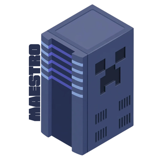
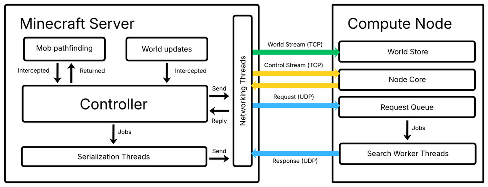

# Maestro
Maestro is a server-side Minecraft mod that offloads mob pathfinding to a fleet of C++ compute nodes. Using Maestro, *servers can handle up to 30 times more mobs while keeping p99 tick time below 50 ms*.

> For the system design in detail and my thinking in building this project, please [read the blog on my personal website](https://davidmenggx.github.io/blog/maestro.html).

*This project is mostly intended as a learning exercise in distributed systems. It is not intended as a complete gameplay mod.*

## Overview

Minecraft runs mob pathfinding on the main server thread, which has a 50 ms budget per game tick.
As mob counts grow, expensive searches cause the game to lag.

Maestro moves these searches to C++ *compute nodes*. A Java *controller* inside the Minecraft server
sends requests asynchronously and applies the returned paths.



Each node holds a replica of its assigned world region, receives ordered block updates over a TCP stream,
and answers pathfinding requests over a UDP channel. Pathfinding searches run on a pool of worker threads
against immutable world snapshots.

The controller assigns regions, splits or replicates hot regions, and reassigns failed nodes’ regions to spares. During failures, mobs reuse recent paths or receive searches within a limited server-side budget.

## Performance

Across eight benchmark scenarios, Maestro supported *1.3-29.9x as many mobs as vanilla Minecraft* while keeping
p99 tick time below 50 ms. Gains in capacity measured by mean tick time were smaller: *1.1-6.1x*.

The largest gains came from workloads with long, expensive paths. Movement and collision physics still run on the main server thread and eventually become the bottleneck.

See the [blog post](https://davidmenggx.github.io/blog/maestro.html) for benchmark methodology and results.

## Build and run

Maestro uses *Minecraft 26.1 with Fabric*. Building requires JDK 25, a C++20 compiler, CMake 3.24+, GNU Make, and Bash. The commands below assume Linux/WSL.

From the repository root:

```bash
make all
```

This builds the compute node at `build/node/maestro-node` and the mod under `server/build/libs/`. Install the mod JAR in your Fabric server's `mods/` directory.

Start a compute node:

```bash
./build/node/maestro-node --bind 127.0.0.1 --workers 4
```

Create `config/maestro.json` in your Minecraft server directory:

```json
{
  "nodes": [{"host": "127.0.0.1"}],
  "spares": 0
}
```

Then start the Minecraft server. This configuration uses one local node, with no spare. An empty node list keeps pathfinding local.

For a larger fleet, list each node's address and reserve a spare:

```json
{
  "nodes": [
    {"host": "10.0.0.11"},
    {"host": "10.0.0.12"},
    {"host": "10.0.0.13"}
  ],
  "spares": 1
}
```

Nodes use TCP ports 25700 and 25701 for world updates and control, and UDP port 25702 for pathfinding. Remote nodes must listen on an address reachable by the server.

See [MaestroConfig.java](server/src/main/java/io/github/davidmenggx/maestro/config/MaestroConfig.java) for all settings.

## Testing

Maestro's tests cover pathfinding, the wire protocol, and failure handling:

- *Vanilla parity:* replay recorded Minecraft searches against the C++ implementation, checking results within the supported semantics.
- *Deterministic simulation:* exercise the production controller with simulated crashes, partitions, delays, and dropped messages. Failures can be reproduced from their random seed.
- *End-to-end tests:* run the released mod against real nodes, including failover, region splits, and replication.

```bash
make test       # C++, Java, and Python unit tests
make fuzz       # Seeded controller simulations
make test-e2e   # Released mod against real nodes
```

To reproduce a simulation run:

```bash
make fuzz SEED=42 RUNS=1
```

## Scope

Maestro offloads eligible ground-pathfinding searches in the Overworld.
Other search types stay local. Nodes search eventually consistent world
replicas using simplified collision geometry, so results can differ from
vanilla in some cases.

## License

[MIT](LICENSE).
